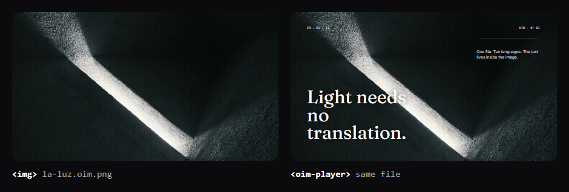

# OIM

[](https://github.com/oim-media/oim/actions/workflows/ci.yml)
[](https://www.npmjs.com/package/@oim-media/player-oim)
[](https://pub.dev/packages/oim_flutter)
[](https://crates.io/crates/oim-media)
[](LICENSE)

Documentation: [English](https://oim.media/docs/) · [Español](https://oim.media/docs/es/)

OIM is an open format for interactive images. An `.oim` file is a PNG that also
carries signed, layered and animated content in a metadata chunk. It still opens
as an ordinary image anywhere; OIM-aware players compose the layers, animations
and interactions on top of it.



Both panels load the same file, [`la-luz.oim.png`](https://oim.media/la-luz.oim.png).
Download it and open it in any image viewer: it is a normal PNG. The ten
translations travel inside it. There is a live demo at [oim.media](https://oim.media).

## Packages & Applications

| Package / App | What it is |
|---|---|
| [`@oim-media/core`](packages/core/README.md) | Contract schema, binary reader, canonical form and the render rules shared by every player. |
| [`@oim-media/player-oim`](packages/player-oim/README.md) | `<oim-player>` web component for `.oim` images. |
| [`@oim-media/player-ovm`](packages/player-ovm/README.md) | Reserved placeholder for `.ovm` interactive video (pending specification). |
| [`@oim-media/spec`](packages/spec/README.md) | Language-neutral contract: JSON Schema, binary and canonical specifications, conformance vectors and the public player keys. |
| [`@oim-media/viewer-desktop`](apps/viewer-desktop/README.md) | Native desktop viewer (Windows, macOS, Linux) built with Tauri v2, `@oim-media/player-oim`, and `@oim-media/core`. |
| [`oim_flutter`](sdks/flutter/README.md) | Native Dart/Flutter SDK: reads, verifies offline and renders `.oim` files with the `OimPlayer` widget. |
| [`oim` (Rust)](sdks/rust/README.md) | Rust crate: reads, verifies offline and interprets `.oim` files. No renderer. |
| [`viewer-flutter`](apps/viewer-flutter/README.md) | Native viewer for Android, iOS and Windows built on `oim_flutter`. |

## Install

```bash
pnpm add @oim-media/player-oim   # npm
flutter pub add oim_flutter       # pub.dev
cargo add oim-media               # crates.io
```

No token or registry configuration is needed.

Start with [`@oim-media/player-oim`](packages/player-oim/README.md) to embed a file in
a page, or [`@oim-media/core`](packages/core/README.md) to read or write metadata.

## Develop

This is a pnpm workspace; use pnpm only.

```bash
pnpm install
pnpm build         # core, player-oim, player-ovm and viewer-desktop
pnpm test          # unit tests of core, player-oim and viewer-desktop
pnpm typecheck     # the typecheck scripts of core, player-oim and viewer-desktop
pnpm conformance   # the conformance vectors in packages/spec/vectors
pnpm test:tools    # the release and packaging scripts in tools/
pnpm check:licenses
```

`pnpm conformance` must stay green for any change to the format, serialization or
rendering. The vectors are described in [`packages/spec`](packages/spec/README.md).
To check a release before tagging, run `node tools/versions.mjs vX.Y.Z` and
`node tools/pack-contents.mjs` after `pnpm build`.

See [CONTRIBUTING.md](CONTRIBUTING.md) for the workflow and [CHANGELOG.md](CHANGELOG.md) for what changed in each release.

## Versioning

The four packages, both viewers and the Rust and Flutter SDKs are released
together under one version, and a release tag
(`vX.Y.Z`) names it. That version must equal the format version, `CONTRACT_VERSION`
in `packages/core/src/compatibility.ts`. See the [spec](packages/spec/README.md#versioning).

- **Minor**: a new node type or field. Older readers ignore what they do not know.
- **Major**: only when an older `.oim` would render differently.
- **Patch**: fixes to how something is drawn, with no change to the format.

## License

Code is licensed under the [Apache License 2.0](LICENSE). The "OIM" name and the
"OIM compatible" mark are not licensed under Apache-2.0; see [NOTICE](NOTICE).

## Security

Report vulnerabilities privately to devs@oim.media, not in public issues. See
[SECURITY.md](SECURITY.md).
